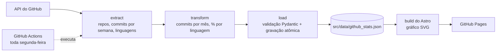

# Portfólio de Pedro Prado — Data Engineer

[](https://github.com/Dev-PPrado/Dev-PPrado.github.io/actions/workflows/deploy.yml)
[](https://github.com/Dev-PPrado/Dev-PPrado.github.io/actions/workflows/collect.yml)

**Site:** https://dev-pprado.github.io

Portfólio pessoal com meus projetos, stack, trilha de estudos e currículo. Além de site, ele também é um pequeno **projeto de engenharia de dados**: um pipeline em Python coleta toda semana dados dos meus repositórios pela API do GitHub, valida, transforma e publica o resultado no site automaticamente.

## O pipeline de dados



Código em [`scripts/collect_github.py`](scripts/collect_github.py), testes em [`tests/test_collect_github.py`](tests/test_collect_github.py).

| Etapa | O que faz |
|---|---|
| **Extract** | Lista os repositórios públicos (sem forks) e busca os commits por semana do último ano e os bytes por linguagem. |
| **Transform** | Função pura: agrega commits por mês (dia a dia, então uma semana que cruza o mês é dividida certo) e calcula a participação de cada linguagem. |
| **Load** | Valida o schema com Pydantic e grava o JSON. O build do site valida o mesmo arquivo de novo com Zod. |

### Decisões de engenharia

- **Falha segura:** se qualquer etapa falhar, o script sai com erro e o JSON anterior é mantido. O site nunca publica dado quebrado.
- **Gravação atômica:** escreve num arquivo temporário e troca de uma vez, então o JSON nunca fica pela metade.
- **Idempotência:** se os dados não mudaram, o arquivo não é regravado. Rodar de novo não gera commit.
- **Retry e plano B:** a API responde `202` enquanto calcula a estatística. O script consulta todos os repositórios, tenta de novo só os pendentes com backoff e, se algum não ficar pronto, conta os commits pela lista de commits no mesmo formato.
- **Testes:** 11 testes com pytest cobrem a transformação (virada de mês e de ano, meses sem commit), a gravação idempotente, a rejeição de dados inválidos e a lógica de retry, com a API simulada.
- **Logs:** cada etapa usa `logging`, então dá para acompanhar a execução pelo GitHub Actions.

### Automação (CI/CD)

| Workflow | Quando roda | O que faz |
|---|---|---|
| [`collect.yml`](.github/workflows/collect.yml) | Toda segunda às 06:00 (Brasília) e manualmente | Roda os testes, executa a coleta e faz commit do JSON **só se ele mudou**. Nesse caso, chama o deploy. |
| [`deploy.yml`](.github/workflows/deploy.yml) | Push na `main`, manualmente ou chamado pelo `collect.yml` | Gera o site com Astro e publica no GitHub Pages. |

O `collect.yml` chama o `deploy.yml` como job porque um commit feito com o `GITHUB_TOKEN` não dispara outros workflows.

## O site

- **Conteúdo separado do código:** projetos são arquivos Markdown e stack/roadmap são JSON. Todos validados por schema (Zod) no build: um campo faltando quebra o build em vez de ir para o ar.
- **Páginas de projeto** com diagrama de arquitetura (Mermaid, carregado só quando aparece na tela) e filtro por tecnologia.
- **Gráfico de atividade** gerado como SVG no build, sem biblioteca JavaScript.
- **Tema claro e escuro**, layout mobile-first e acessível.
- **SEO:** link canônico, Open Graph, sitemap e `robots.txt`.
- **Lighthouse 100** em desempenho, acessibilidade, boas práticas e SEO (medido em 09/10/2026, na home e numa página de projeto).

## Stack

| Parte | Tecnologias |
|---|---|
| Pipeline | Python 3.14, httpx, Pydantic, pytest, uv |
| Site | Astro 7, Tailwind CSS 4, TypeScript, Mermaid |
| Infraestrutura | GitHub Actions, GitHub Pages |

## Como rodar localmente

Pré-requisitos: Node.js 22.12+ e [uv](https://docs.astral.sh/uv/).

```sh
# site
npm install
npm run dev          # servidor de desenvolvimento em http://localhost:4321
npm run build        # build de produção (também valida os schemas)
npm run check        # checagem de tipos

# pipeline
uv run pytest tests/                                  # testes
GITHUB_TOKEN=<seu token> uv run scripts/collect_github.py   # coleta (com o gh CLI: GITHUB_TOKEN=$(gh auth token))
```

## Estrutura

```text
.
├── .github/workflows/    # deploy.yml e collect.yml
├── scripts/              # collect_github.py (pipeline)
├── tests/                # testes do pipeline
├── src/
│   ├── content/          # perfil.md e projects/*.md
│   ├── data/             # stack.json, roadmap.json, github_stats.json (gerado)
│   ├── components/       # Hero, ProjectCard, StackPanel, Timeline, ActivityChart...
│   ├── pages/            # home, projetos/ e projetos/[slug]
│   ├── i18n/pt.ts        # textos fixos de interface
│   └── content.config.ts # schemas das coleções (Zod)
├── public/               # favicon, og.png, cv.pdf, robots.txt
└── assets-src/           # fontes das imagens estáticas
```

## Como adicionar um projeto

Crie um arquivo em `src/content/projects/<nome>.md` e faça commit. A página, o card e o filtro são gerados a partir dele.

```markdown
---
titulo: Nome do projeto
resumo: Uma frase sobre o que ele faz.
problema: Que problema ele resolve.
solucao: Como ele resolve.
stack: [Python, Airflow, PostgreSQL]
repo: https://github.com/Dev-PPrado/<repo>
data: 2026-10          # AAAA-MM
destaque: true         # aparece na home
status: em desenvolvimento   # em desenvolvimento | concluído | pausado
---

## Arquitetura
(diagrama em um bloco mermaid)

## O que aprendi
```

O arquivo `src/data/github_stats.json` é gerado pelo pipeline e não deve ser editado à mão.
