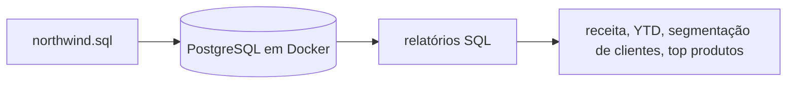

## Arquitetura

## O que aprendi

[//]: # (Texto provisório e genérico; revisar com o Pedro.)

- Escrever consultas analíticas em SQL que vão além do SELECT básico: JOINs entre várias tabelas, agregações e CTEs para quebrar uma pergunta grande em partes menores.
- Usar window functions (LAG, SUM OVER, NTILE) para comparar períodos, acumular valores e segmentar clientes sem precisar de subconsultas complicadas.
- Traduzir uma pergunta de negócio em uma consulta e conferir se o resultado faz sentido.
- Subir o PostgreSQL e o pgAdmin com Docker Compose, para que o ambiente seja o mesmo em qualquer máquina.
