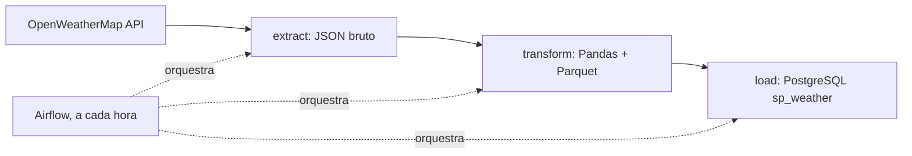

## Arquitetura

Projeto de estudo construído a partir do tutorial da VBLUUIZA e evoluído a partir dele.

## O que aprendi

TODO: preencher com o Pedro.

## Próximos passos

Validação e qualidade dos dados, testes automatizados, tratamento de erros com retries, carga incremental e arquitetura medallion (bronze, silver, gold).
