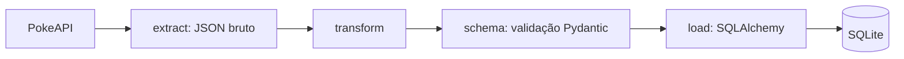

## Arquitetura

Configuração em `src/config` (banco, logging e variáveis de ambiente via `.env`). Há um teste com pytest que verifica a criação da tabela no banco.

## O que aprendi

[//]: # (Texto provisório e genérico; revisar com o Pedro.)

- Separar o código em módulos (extract, transform, schemas, load), o que deixa cada parte mais fácil de entender e testar.
- Validar os dados com Pydantic antes de gravar, para que um registro inválido não chegue ao banco.
- Usar logging em vez de print e tratar erros sem derrubar a execução inteira.
- Configurar o projeto com variáveis de ambiente, gerenciar dependências com uv e escrever um primeiro teste com pytest.
