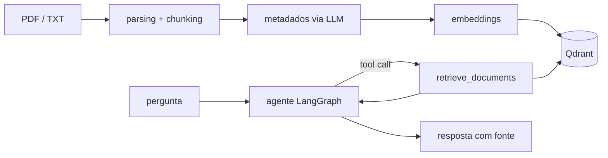

## Arquitetura

A API tem endpoints para criar e remover coleções, para enviar, substituir e remover documentos e para conversar com o agente. Para testar tudo localmente, há uma interface web simples (`index.html`).

Projeto final do módulo de RAG da trilha de Engenharia de IA da Jornada de Dados.

## Os conceitos por trás do projeto

Um modelo de linguagem sabe muita coisa sobre o mundo, mas não sabe nada sobre os seus documentos. Se você pergunta sobre um contrato ou um edital que ele nunca leu, ele pode até inventar uma resposta convincente. O RAG (*Retrieval-Augmented Generation*, ou geração aumentada por recuperação) resolve isso com uma ideia simples: antes de responder, o sistema procura nos documentos os trechos que falam do assunto e entrega esses trechos ao modelo junto com a pergunta. Assim ele deixa de responder de memória e passa a responder com base no material.

Para isso funcionar, os documentos passam por algumas etapas antes da primeira pergunta.

### Parsing: do arquivo para o texto

Tudo começa extraindo o texto. Um PDF não guarda parágrafos, guarda a posição de cada letra na página, então é preciso uma biblioteca que reconstrua o texto. Aqui o PyMuPDF lê o PDF página por página. Cada pedaço de texto é guardado junto com o número da página de onde saiu, e é isso que mais tarde permite à resposta citar a fonte.

### Chunking: dividir em pedaços do tamanho certo

Um documento inteiro é grande demais para ser comparado com uma pergunta, então ele é dividido em pedaços menores, os *chunks*. O tamanho importa: pedaços pequenos demais perdem o contexto, e pedaços grandes demais misturam vários assuntos e atrapalham a busca.

No projeto dá para ajustar isso a cada envio:

- **Tamanho e sobreposição:** a sobreposição (*overlap*) repete o finalzinho de um pedaço no começo do próximo, para que uma ideia não seja cortada ao meio.
- **Tipo de divisor:** o recursivo tenta cortar primeiro entre parágrafos, depois entre frases e só então entre palavras, respeitando a estrutura do texto. O divisor por caractere corta sempre no mesmo separador.
- **Contagem por tokens:** o tamanho pode ser medido em tokens (com o `tiktoken`), que é a unidade que o modelo realmente enxerga, em vez de caracteres.

### Metadados: etiquetas para cada pedaço

Ao receber um documento, o sistema manda a primeira página para o LLM e pede duas coisas: uma classificação curta (por exemplo, "artigo científico") e uma descrição de até duas frases. A resposta vem em formato estruturado e é validada pelo Pydantic. Essas etiquetas, junto com o nome do arquivo e a página, ficam guardadas com cada pedaço.

### Embeddings: transformar significado em números

Um *embedding* é uma lista de números que representa o sentido de um texto. Textos com significado parecido ganham números parecidos, mesmo sem nenhuma palavra em comum: "como cancelar minha assinatura" fica perto de "quero encerrar o meu plano". É isso que permite buscar por significado, e não só por palavra-chave. Aqui cada pedaço vira um vetor de 3072 números gerado pelo modelo `text-embedding-3-large` da OpenAI.

### Banco vetorial: buscar por proximidade

Um banco de dados comum procura valores exatos: o cliente com tal CPF, os pedidos de tal data. Um banco vetorial procura proximidade: quais vetores estão mais perto deste. O Qdrant guarda cada pedaço como um ponto, com o vetor e, ao lado, o texto original e os metadados. Quando chega uma pergunta, ela também vira um embedding, e o Qdrant devolve os 5 pedaços mais próximos dela. Cada coleção funciona como uma base separada, então a mesma aplicação pode atender assuntos diferentes sem mudar o código.

### RAG agêntico: decidir quando buscar

No RAG tradicional o caminho é fixo: toda mensagem dispara uma busca, até um simples "oi, tudo bem?". Isso gasta chamadas e tokens à toa e ainda enche a resposta de contexto que não tem nada a ver com a conversa.

Neste projeto o modelo funciona como um **agente**. Ele recebe uma ferramenta, a `retrieve_documents`, e decide sozinho quando usá-la. Numa saudação, responde direto. Numa pergunta sobre o conteúdo dos documentos, chama a ferramenta, lê os trechos que voltaram e monta a resposta citando de onde tirou cada informação, no formato `[Fonte: arquivo, página]`.

Por baixo, isso é um grafo do LangGraph com dois nós, o `agent` e o `tools`. O agente fala primeiro. Se pedir a ferramenta, ela roda e o resultado volta para ele, e esse vai e volta se repete até o agente ter o que precisa e responder sem pedir mais nada.

### Observabilidade: enxergar o que aconteceu

Uma aplicação com LLM não segue sempre o mesmo caminho, então, quando uma resposta sai estranha, é preciso entender por quê. O Langfuse registra cada conversa passo a passo: o que o agente decidiu, quais trechos a busca devolveu, quantos tokens foram gastos e quanto tempo cada etapa levou.

## O que aprendi

[//]: # (Texto provisório; revisar com o Pedro.)

- Que a qualidade de um RAG começa bem antes do modelo: um parsing ruim ou chunks mal cortados atrapalham a resposta mais do que a escolha do LLM.
- Como os embeddings permitem buscar por significado e como um banco vetorial como o Qdrant organiza e encontra esses vetores.
- A diferença entre um RAG de fluxo fixo e um agente que decide quando buscar, e como montar esse agente com LangGraph e *tool calling*.
- Pedir saída estruturada ao LLM e validá-la com Pydantic, para que os metadados cheguem ao banco sempre no mesmo formato.
- Acompanhar uma aplicação com LLM pelo Langfuse, olhando decisões, tokens e tempo de resposta em vez de adivinhar o que aconteceu.
