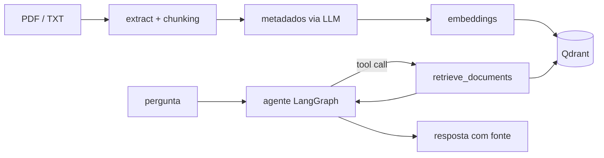

## Arquitetura

A API expõe endpoints para criar e remover coleções, ingerir, substituir e remover documentos, e conversar com o agente. Uma interface web simples (`index.html`) permite testar tudo localmente.

Projeto final do módulo de RAG da trilha de Engenharia de IA da Jornada de Dados.

## O que aprendi

[//]: # (Texto provisório e genérico; revisar com o Pedro.)

- Montar um fluxo de ingestão de documentos: extrair texto, dividir em chunks e gerar embeddings.
- Usar um banco vetorial (Qdrant) para guardar e buscar trechos por similaridade.
- Construir um agente com LangGraph e tool calling, deixando o LLM decidir quando buscar contexto.
- Gerar metadados com saída estruturada do LLM validada por Pydantic.
- Acompanhar chamadas, tokens e latência de uma aplicação com LLM usando o Langfuse.
